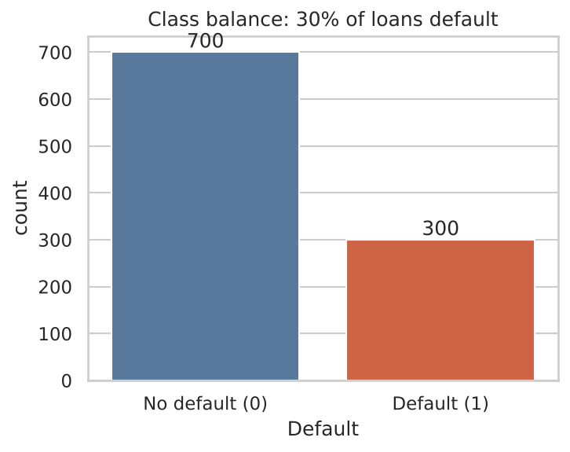
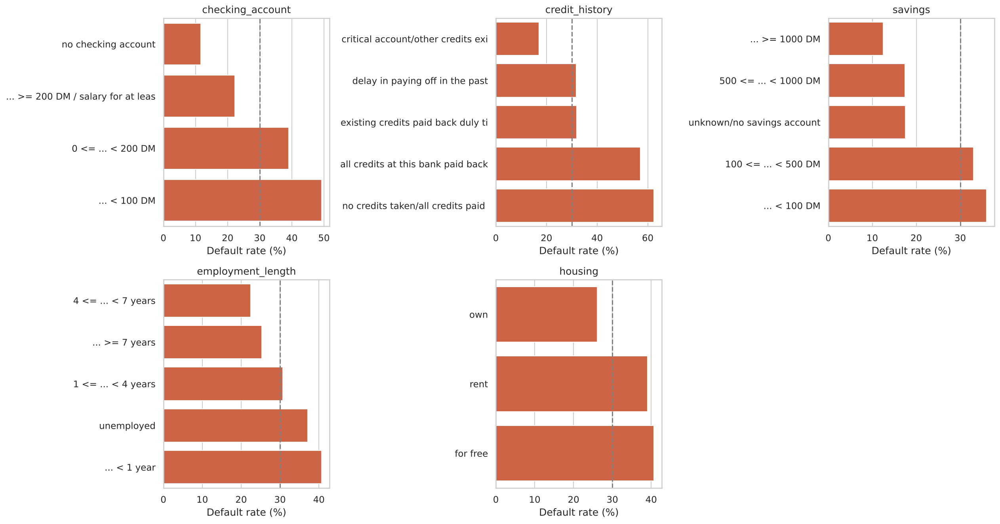
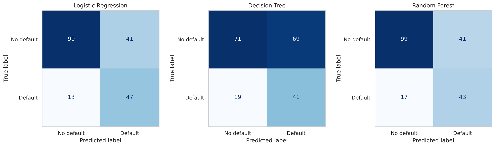
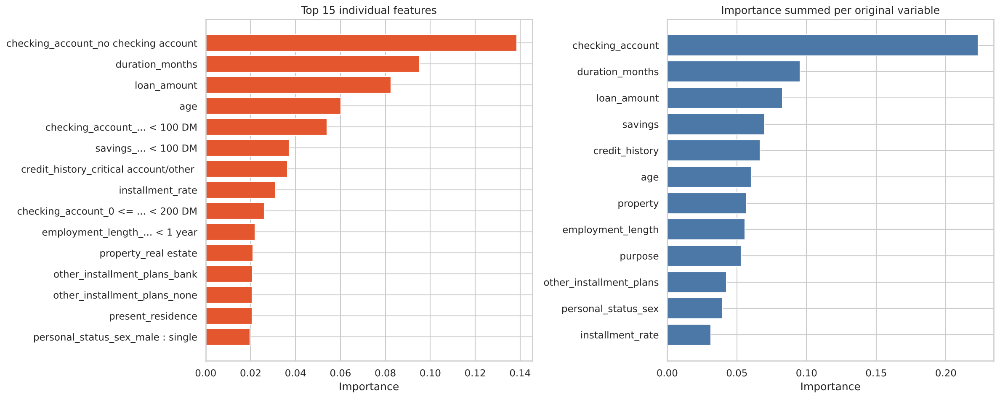

# Credit Risk Prediction Using Machine Learning

**Author:** Elifnaz Sen · BSc Mathematics, Statistics and Data Science (Year 2), University of Bath
[LinkedIn](https://www.linkedin.com/in/elifnaz-sen-26ba20175) · [GitHub](https://github.com/elifnazsen)


## Project Overview

## Project Overview

Developed a machine learning classification model to predict customer loan default risk using demographic and financial information from the UCI German Credit dataset (1,000 loans, 30% defaults). The project covers data cleaning, exploratory analysis with statistical testing, three classification models, evaluation with cross-validation, and a business interpretation including a cost-of-errors analysis.

**Target:** `Default` (0 = no default, 1 = default).

## Technologies Used

- Python
- Pandas, NumPy
- SciPy (hypothesis tests)
- Seaborn, Matplotlib
- Scikit-Learn

## Models Used

- Logistic Regression (baseline)
- Decision Tree
- Random Forest

Each model sits in a scikit-learn `Pipeline` (one-hot encoding + `StandardScaler` + classifier) so that preprocessing is fitted on training data only, which prevents data leakage. Hyperparameters were tuned with 5-fold stratified cross-validation, and models were compared with nested cross-validation.

## Results

Nested 5-fold cross-validation on all 1,000 loans (mean ± std across folds; "default" is the positive class):

| Model | Accuracy | Precision | Recall | F1 | ROC-AUC |
|---|---|---|---|---|---|
| Baseline (approve everyone) | 70.0% | 0% | 0% | 0% | 0.50 |
| Logistic Regression | 72.4 ± 2.9% | 53.2 ± 3.8% | 71.3 ± 3.9% | 60.9 ± 3.0% | 0.785 ± 0.027 |
| Decision Tree | 62.1 ± 5.4% | 43.3 ± 4.7% | 75.3 ± 9.5% | 54.4 ± 3.0% | 0.694 ± 0.027 |
| **Random Forest** | **73.1 ± 1.2%** | **54.0 ± 1.6%** | **70.0 ± 3.2%** | **60.9 ± 1.7%** | **0.796 ± 0.022** |

(The baseline row is from the single 80/20 test split; the other rows are nested CV. The notebook also shows the single test-split table and confusion matrices.)

**Best model: Random Forest and Logistic Regression are statistically tied.** Random Forest has the highest ROC-AUC (≈0.80) and the most stable results, but the gap to Logistic Regression is smaller than one standard deviation, so I do not claim it is better. The Decision Tree is clearly the weakest. Given similar performance, the more explainable Logistic Regression is arguably the better practical choice.

**An honest note on accuracy:** a model that approves everyone is already 70% accurate, so ~73% accuracy is a modest gain. The more meaningful measure is ROC-AUC ≈ 0.79: a randomly chosen defaulter gets a higher risk score than a randomly chosen non-defaulter about 79% of the time.

### Key findings

- **Checking account status is the strongest predictor** (49% default with a balance under 100 DM vs 12% with no checking account), confirmed by both impurity and permutation importance.
- Longer and larger loans, low savings, short employment and younger age are all associated with higher default (chi-square and Mann-Whitney tests, p < 0.01). Default rate jumps to ~46% for loans over 6,000 DM.
- With an assumed 5:1 cost of a missed defaulter vs a declined good customer, any model cuts illustrative losses by ~58-66% versus approving everyone.
- Unexpectedly, employment length adds little once other variables are known.

## Selected Visuals

| Class balance | Default rate by category |
|---|---|
|  |  |

| Confusion matrices | Random Forest feature importance |
|---|---|
|  |  |

## Project Structure

```
credit-risk-prediction/
├── README.md
├── requirements.txt
├── data/
│   ├── german_credit_raw.csv
│   └── README.md               # dataset source and notes
├── notebooks/
│   └── credit_risk_analysis.ipynb   # full analysis, all 6 phases
├── src/
│   └── models.py               # data loading, pipelines, tuning, evaluation helpers
└── visuals/                    # all charts saved as PNG
```

## How to Run

```bash
pip install -r requirements.txt
```

```bash
jupyter notebook notebooks/credit_risk_analysis.ipynb
```

Run all cells (about 2-3 minutes; the nested cross-validation is the slow step). Random seeds are fixed, so results are reproducible.

## Limitations

- Small dataset (1,000 loans, 300 defaults), so results carry real uncertainty.
- Historical data; would need retraining on current data.
- No income variable (the original dataset does not contain one).
- Contains sensitive attributes (age, sex/marital status, foreign worker) and only previously approved applicants, so there is a risk of historical bias and fairness issues.
- The 5:1 cost ratio is taken from the dataset documentation, not a real lender.

## Future Improvements

XGBoost/LightGBM, more customer features (income, debt-to-income), larger datasets, SHAP explanations, a fairness audit, and a real-time prediction API.

## Key Learning Outcomes

- Data cleaning (missing values, duplicates, outliers, encoding, scaling without leakage)
- Statistical analysis (confidence intervals, chi-square, Mann-Whitney U, Cramér's V, correlation)
- Machine learning classification (class imbalance, hyperparameter tuning, pipelines)
- Model evaluation (precision/recall/F1/ROC-AUC, confusion matrices, nested cross-validation, baselines)
- Business interpretation (cost-sensitive thresholds, fairness, explainability)

## CV Entry

**Credit Risk Prediction Model | Python, Pandas, Scikit-Learn** *(personal project)*
- Built classification models (Logistic Regression, Decision Tree, Random Forest) to predict loan default on 1,000 customer records, using pipelines to avoid data leakage and nested cross-validation for a fair comparison.
- Applied statistical tests (chi-square, Mann-Whitney U) and identified checking-account status, loan size/duration and savings as key risk drivers; achieved ROC-AUC of ~0.79 against a 70%-accuracy do-nothing baseline.
- Quantified business impact with a cost-sensitive analysis (illustrative ~60% lower cost than approving everyone, but only ~25% lower than rejecting everyone) and discussed limitations including bias, fairness and explainability.

## Acknowledgemnts

This project was developed with the assistance of AI tools for code generation and project scaffolding. All analysis, testing, interpretation of results, and project validation were completed by me.